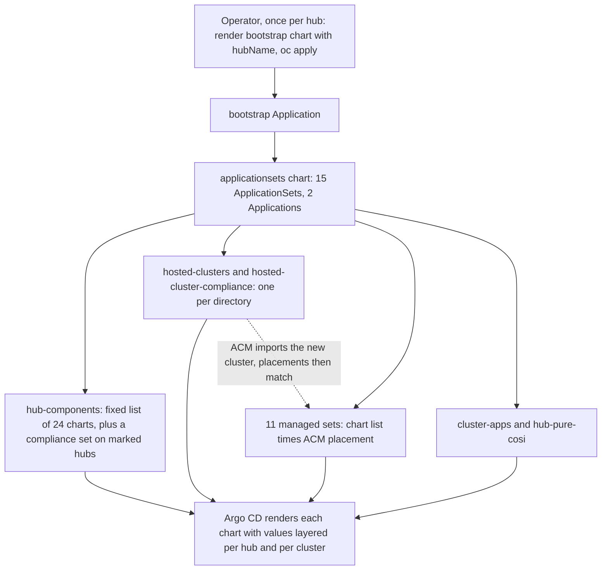
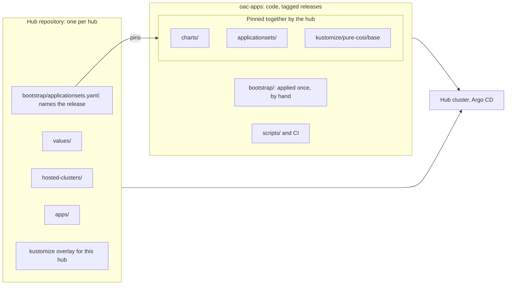
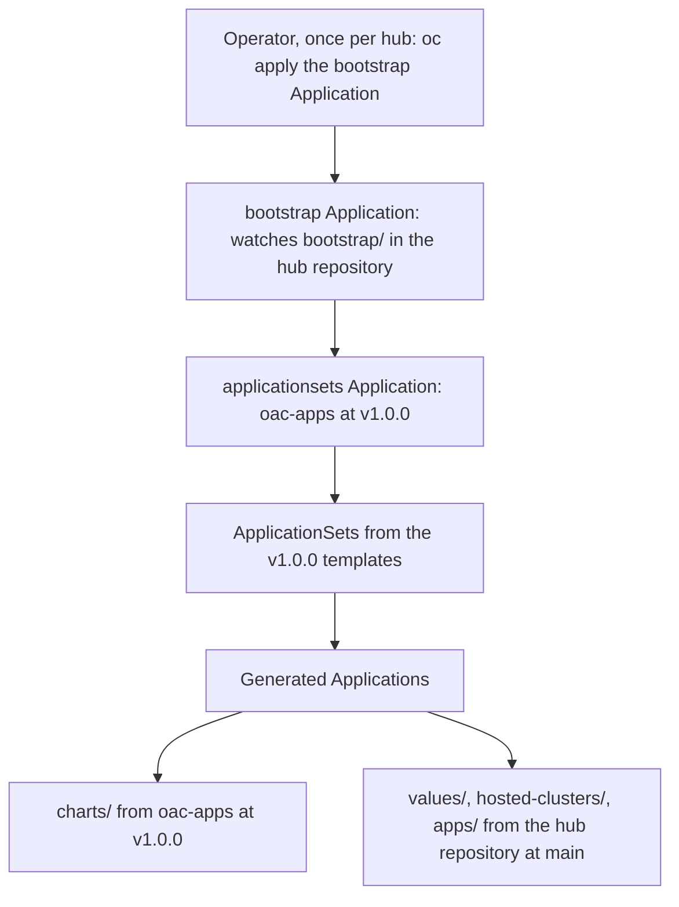

> [!NOTE]
> This is a draft, opened to get discussion going toward a consensus. It
> writes up the approach tzumainn proposed in [MOC-issues #802][802], with
> the compliance layering EldritchJS described in [MOC-issues #803][803].
> The structure is theirs. Two parts are additions that nobody has agreed to
> yet: the default for the configuration repository URL, and pinning
> `applicationsets` together with the charts. Both are listed under open
> questions, and the document should change to match whatever #802 settles.

## Context

`oac-apps` holds both the Helm charts we deploy and the configuration of every
cluster that deploys them, and every hub tracks its `main` branch. Right now
it is one big bundle, and that is unlikely to be viable long-term
([MOC-issues #801][801]). A commit to `oac-apps` can immediately affect every
running cluster, so there is no way to move a change from development to
staging to production ([MOC-issues #804][804]).

### How a hub is assembled today



Every arrow in that picture reads `oac-apps` at `main`. At commit `d513176`
that is 28 references in 24 files: the bootstrap Application, the 17 templates
under `applicationsets/templates/`, and six drop-in Applications under
`apps/`.

### What is in the repository

| Item | Count |
|---|---|
| Hubs | 5 (`oac-dev-infra`, `oac-prod-infra`, `nist-dev-infra`, `bu-ist-demo-infra`, `compliant-dev-infra`) |
| Hosted clusters | 6 |
| Charts | 57 |
| Directories keyed by hub name | 4 (`values/`, `hosted-clusters/`, `apps/`, `kustomize/pure-cosi/overlays/`) |

### What works and should be kept

The charts themselves are hub-agnostic. No chart template contains a hub or
cluster name, and no chart carries a `repoURL` or `targetRevision`. Everything
hub-specific arrives through the values layering from the multi-hub design,
with `hubName` as the single per-hub input. That separation is what makes a
split practical, and this ADR does not change it.

### What is difficult

1. A change cannot be promoted. A merge to `main` reaches every hub at once:
   development, staging, production and compliant hubs alike. There is no
   point at which a change is approved for a particular hub, and no record of
   what a hub was running at a given time (NIST 800-171 3.4.3, configuration
   change control).
2. All hubs' configuration sits under the same write permissions. Restricting
   who may change a compliant hub is a convention, not a repository setting
   (3.4.5, access restrictions for change).
3. The common component list does not fit every hub. `hub-components` deploys
   the same 24 charts everywhere. Rendering each chart with each hub's values
   gives the following. This is from rendering the charts, not from Argo CD on
   the clusters, and still needs confirming there.

   | Hub | Charts that render | Charts that fail on a required value |
   |---|---|---|
   | `oac-dev-infra` | 24 of 24 | none |
   | `oac-prod-infra` | 24 of 24 | none |
   | `nist-dev-infra` | 22 of 24 | `lvmcluster`, `cluster-version` |
   | `bu-ist-demo-infra` | 22 of 24 | `lvmcluster`, `object-storage-proxy` |
   | `compliant-dev-infra` | 24 of 24 | none |

   We already work around this in two ways. `github-oauth`,
   `github-group-sync` and `keycloak-oauth` are per-hub drop-ins under `apps/`
   (`keycloak-oauth` is now a drop-in on four of the five hubs). Compliance
   charts are switched on per hub by the `compliance.yaml` marker, through
   `hub-components-compliance` and `hosted-cluster-compliance`.

## Decision

We separate code from configuration, following the discussion in
[MOC-issues #802][802].

- `oac-apps` becomes the code repository and starts tagging releases.
- Each hub, together with its hosted clusters, gets its own configuration
  repository.
- Each hub repository states which release of `oac-apps` the hub runs.
- Existing OAC hubs are not migrated. They are due to be decommissioned, and
  their directories are removed from `oac-apps` when they go.

### Repository layout



| Directory | Today | After |
|---|---|---|
| `charts/` | `oac-apps` | `oac-apps` |
| `applicationsets/` | `oac-apps` | `oac-apps` |
| `bootstrap/` | `oac-apps` | `oac-apps` |
| `kustomize/pure-cosi/base` | `oac-apps` | `oac-apps` |
| `values/<hub>/` | `oac-apps` | hub repository |
| `hosted-clusters/<hub>/`, including the `compliance.yaml` marker | `oac-apps` | hub repository |
| `apps/<hub>/` | `oac-apps` | hub repository |
| `kustomize/pure-cosi/overlays/<hub>/` | `oac-apps` | hub repository |

Hub repositories keep the directory structure we have today. The kustomize
overlay moves with the rest because it is also keyed by hub name, and
`hub-pure-cosi` reads it by path.

### Finding the hub repository

The location of the hub repository is a value with a default, so that a hub
which sets nothing keeps reading its configuration from `oac-apps`:

<!--  -->
```
{{- $hub := required "hubName must be set" .Values.hubName }}
{{- $configRepoURL := .Values.configRepoURL | default "https://github.com/CCI-MOC/oac-apps.git" }}
```
<!--  -->

An earlier sketch in [#802][802] derived the URL from the hub name
(`CCI-MOC/<hub>-config`). Because every hub tracks `main`, the existing hubs
would pick up that template on merge and look for repositories that do not
exist. With the default, and with `chartsVersion` defaulting to `main`,
existing hubs are unaffected and only a new hub sets either value. It also
keeps the repository naming convention out of the templates.

This was applied to `bootstrap` and `hub-components` in a scratch copy and
rendered for both cases (Helm v4 template engine, no cluster):

| Case | Configuration source | Charts source |
|---|---|---|
| Existing hub, nothing set | `oac-apps` at `main` | `oac-apps` at `main` |
| New hub, both values set | hub repository at `main` | `oac-apps` at `v1.0.0` |

### Visibility and access

Hub repositories hold the values that [ops-docs PR #49][ops49] proposes to
keep out of public repositories: IP addresses, hostnames and network
topology. The split described here gives those values a natural home, so hub
repositories should be able to be private, with the charts staying public.

That has two consequences:

- Argo CD needs a read credential for a private hub repository. It has to
  exist in `openshift-gitops` before the bootstrap Application is applied, so
  bringing up a hub gains one step. Argo CD supports GitHub App credentials
  for repositories; which credential we use is an open question.
- Hub repositories, their branch protection and their required reviewers are
  created through [moc-github][moc-github], in line with the change control
  described in [ops-docs PR #59][ops59].

### Where the version is written

The release is pinned in the hub repository, in one place, and covers both
the ApplicationSet templates and the charts they deploy.

The earlier sketch in [#802][802] put `chartsVersion` in a `bootstrap.yaml`
in the hub repository and used it for the chart source only, leaving the
`applicationsets` path on `main`. That allows skew: if a component is added
to `hub-components` on `main`, a hub pinned at `v1.0.0` generates an
Application for a chart that is not in its release. A change to an
ApplicationSet template would also reach a compliant hub without passing that
hub's review.

Instead, the hand-applied bootstrap Application does one thing, which is to
watch a directory in the hub repository:

```yaml
apiVersion: argoproj.io/v1alpha1
kind: Application
metadata:
  name: bootstrap
  namespace: openshift-gitops
spec:
  project: default
  source:
    repoURL: https://github.com/CCI-MOC/moc-1.5-dev-hub.git
    targetRevision: main
    path: bootstrap
  destination:
    server: https://kubernetes.default.svc
    namespace: openshift-gitops
  syncPolicy:
    automated:
      prune: true
      selfHeal: true
```

That directory holds one file, `bootstrap/applicationsets.yaml`, which is the
pin:

```yaml
apiVersion: argoproj.io/v1alpha1
kind: Application
metadata:
  name: applicationsets
  namespace: openshift-gitops
spec:
  project: default
  source:
    repoURL: https://github.com/CCI-MOC/oac-apps.git
    targetRevision: &release v1.0.0
    path: applicationsets
    helm:
      parameters:
        - name: hubName
          value: moc-dev
        - name: configRepoURL
          value: https://github.com/CCI-MOC/moc-1.5-dev-hub.git
        - name: chartsVersion
          value: *release
  destination:
    server: https://kubernetes.default.svc
    namespace: openshift-gitops
  syncPolicy:
    automated:
      prune: true
      selfHeal: true
```

The YAML anchor means the release is typed once, so the templates and the
charts cannot drift apart. The repository name `moc-1.5-dev-hub` is a
placeholder.



### Promoting a release to a hub

A release reaches a hub through a pull request to that hub's repository which
changes the one line in `bootstrap/applicationsets.yaml`.

- The pull request is the approval, and the repository history is the record
  of what the hub ran and when.
- Review rules are per repository. A compliant hub can require a compliance
  reviewer through CODEOWNERS and branch protection without affecting a
  development hub.
- A development hub may set the release to `main` and behave as hubs do today.
- Development, staging and production hubs each carry their own pin, so a
  release moves from one to the next as one small pull request per hub.
- Hubs that should move together pin the same tag. One shared release for all
  compliant hubs and a release per hub are both expressible, and the choice
  can change later without touching the templates.

This is the first of the three layers set out in [MOC-issues #803][803],
expressed as a per-hub pin instead of a shared tag or `compliant` branch. The
other two layers are unchanged by this ADR: CI that renders charts with a
compliant hub's values, and admission policy with the Compliance Operator on
the cluster. The CI layer has a natural home on the promotion pull request,
where the old and new release can be rendered with that hub's values and the
difference attached.

### Rollout

1. Add `configRepoURL` and `chartsVersion` to the `bootstrap` and
   `applicationsets` charts, both defaulting to today's behavior. No hub
   changes.
2. Start tagging releases of `oac-apps`.
3. Create the hub repository for MOC 1.5 development and bring that hub up
   from it.
4. When the current OAC clusters are decommissioned, remove the hub
   directories from `oac-apps`.
5. Rename `oac-apps` if desired.

### Alternatives considered

| Alternative | Why not chosen |
|---|---|
| Only accept compliant changes into `oac-apps` | Rejected in [#803][803]: compliance depends on the values and the target cluster, not the chart alone, and it puts the burden on every contributor. |
| Separate compliant and non-compliant charts | Rejected in [#803][803]: they drift, and fixes are made twice. |
| A `compliant` or per-hub branch in `oac-apps` | Workable. Promotion becomes a branch move in the code repository, and the multi-hub design chose a single `main` specifically to avoid per-hub branches. |
| Pin only the charts and leave `applicationsets` on `main` | Simpler, with one fewer level. Allows the skew described above, and template changes reach a compliant hub unreviewed. |
| Move `charts/` out and leave configuration in `oac-apps` | Same versioning, but one configuration repository for all hubs, so no per-hub access control, and every existing hub breaks at once when the chart paths move. |
| Pass the release on the bootstrap command line | The pin would live in a cluster object, not in Git. No review and no history. |

## Consequences

### Easier

- Knowing what a hub runs. It is one line in one file, with history.
- Gating a compliant hub. Review and write access are settings on that hub's
  repository.
- Changing a chart without touching production. Nothing moves until a hub
  takes the release.
- Standing up a new hub. The hub repository is small and self-contained.
- Mirroring for a disconnected site. A tagged release is something that can be
  copied; `main` is not.

### Harder

- A fix takes two steps to reach a hub: a release of `oac-apps`, then a pull
  request per hub. For a compliant hub the delay is intended. For an urgent
  fix it is overhead, and the answer in [#803][803] is fast promotion, not a
  second development line.
- A change that alters a chart's values interface can no longer land in one
  commit with its values. Required values and breaking changes need to be
  stated in release notes.
- There is one more level in the chain (bootstrap, `applicationsets`,
  ApplicationSets, Applications).
- The hub repository names a path inside `oac-apps`. Renaming
  `applicationsets/` would touch every hub repository.

### Work this implies

- Every template under `applicationsets/templates/` takes the configuration
  repository as a second source and uses the pinned release for the chart
  source.
- The git generators in `hosted-clusters`, `hosted-cluster-compliance` and
  `hub-components-compliance` read cluster directories and the
  `compliance.yaml` marker. They need the configuration repository URL in the
  generator, not only in the chart source.
- `cluster-apps` reads `apps/<hub>/` and needs the same.
- Drop-ins under `apps/<hub>/` are raw Applications that name a chart at
  `main`. In a hub repository each would carry the release again. Driving
  per-hub components from the ApplicationSets instead, either by a marker as
  compliance does now or by a list in the `applicationsets` values, would
  fold them under the single pin and also address the component-list problem
  in the Context section.
- The `pure-cosi` overlay would reference its base across repositories with
  its own ref. Converting `pure-cosi` to a chart would avoid a second place
  where the version is written.
- `scripts/check-values-files.sh` compares values files to `charts/`, and the
  ApplicationSet unit tests use real hub names. Those checks need both
  repositories or need to move.
- Tags can be moved. A compliant hub should pin a protected tag or a commit
  SHA.
- Private hub repositories need a repository credential in each hub's Argo
  CD, created before bootstrap and rotated.
- New hub repositories and their review rules are added in `moc-github`.

### Not yet tested

- Argo CD behavior on a cluster: two sources that point at the same repository
  (the existing-hub case), `ignoreMissingValueFiles` with a `$config` ref, and
  the YAML anchor surviving manifest parsing.
- A release bump rolling through all four levels.
- Argo CD reading a private hub repository as a `$config` ref source.
- Whether the Applications in the Context table are in error on
  `nist-dev-infra` and `bu-ist-demo-infra` today.

### Open questions

1. Is pinning `applicationsets` together with the charts worth the extra
   level, or is pinning only the charts enough to start with? Likewise, is a
   default of `oac-apps` for the configuration repository URL acceptable, or
   should existing hubs get hub repositories too?
2. What is the naming convention for hub repositories?
3. Who promotes a release to a compliant hub, how often, and who is the
   compliance reviewer? The discussion in [#803][803] suggests roughly monthly
   promotion and a reviewer from IS&T or InfoSec, possibly with an automated
   first pass. None of that is settled.
4. Do all compliant hubs share one release tag to start with, or does each
   move on its own? The pin allows either.
5. Should per-hub components be driven by markers, as compliance is now, or
   by a list in values, replacing the drop-ins?
6. Do hubs that share an environment (for example development, staging and
   production for MOC 1.5) each get a repository, or share one with a
   directory per hub?
7. Are hub repositories private ([ops-docs PR #49][ops49]), and which
   credential does Argo CD use to read them?

## See also

- [MOC-issues #801][801]: Define interaction between our clusters and the
  charts in `oac-apps`
- [MOC-issues #802][802]: How we will handle interaction between clusters and
  `oac-apps`
- [MOC-issues #803][803]: How do we ensure non-compliant changes don't sneak
  into compliant clusters?
- [MOC-issues #804][804]: Implement desired changes to oac-apps and possible
  new cluster repositories
- [Multi-hub values layering design][multihub] in `oac-apps`
- [ops-docs PR #49][ops49]: Split platform configuration into public and
  private repositories
- [ops-docs PR #59][ops59]: GitOps Reconciliation and Change Control
- [ADR PRs policy](../../policies/2026-10-22-adr-prs/)

[801]: https://github.com/CCI-MOC/MOC-issues/issues/801
[802]: https://github.com/CCI-MOC/MOC-issues/issues/802
[803]: https://github.com/CCI-MOC/MOC-issues/issues/803
[804]: https://github.com/CCI-MOC/MOC-issues/issues/804
[multihub]: https://github.com/CCI-MOC/oac-apps/blob/d51317683a6b262c7d1470a113710ef134750cbf/docs/superpowers/specs/2026-08-26-multi-hub-values-layering-design.md
[ops49]: https://github.com/CCI-MOC/ops-docs/pull/49
[ops59]: https://github.com/CCI-MOC/ops-docs/pull/59
[moc-github]: https://github.com/CCI-MOC/moc-github
